# App Factory

**From an app idea to a finished, tested and documented app, with one command: `/factory`.**

You bring an idea and answer a short brainstorm. App Factory writes the full spec, then builds the app block by block. Every block is developed, checked by a quality gate, reviewed by an independent agent, documented and committed. You are asked only when a real decision is needed, and always as a multiple-choice question with a recommended option.

<p align="center">
  
</p>
<p align="center"><sub>Animation also available as a <a href="docs/assets/workflow.gif">GIF</a>.</sub></p>

No shell scripts. App Factory is Markdown skills and roles, plus JSON templates, driven by your coding agent's own tools.

---

## Install

**Claude Code** (plugin):

```bash
claude plugin marketplace add RTekaya/app-factory && claude plugin install app-factory@app-factory
```

**Codex, Cursor, Gemini CLI, GitHub Copilot and others** (also works in Claude Code, as editable files):

```bash
npx skills@latest add RTekaya/app-factory
```

## Quick start

In an empty folder, run your agent (in Claude Code, switch to your strongest model for the brainstorm: `/model opus`), then:

```
/factory "a habit tracker web app: one screen, no account, data stays in the browser"
```

What you will see:

1. **One setup question** (models, budget, git, pauses), with recommended answers first.
2. **A brainstorm** that challenges the idea, proposes angles and cuts the MVP, then **grills** the draft brief until no branch is left open. Say "lock it" when you are happy.
3. **The spec writes itself**: PRD, UX, design system, architecture, plan, then an independent review.
4. **The build runs block by block**, with one line per block: `B04 Habit commands · done · 1 attempt · sonnet→opus`.
5. **A question only when needed**: a blocked block, a scope change, or a milestone if you asked for that pause.

---

## The workflow

| # | Phase | Who | Produces | You |
|---|---|---|---|---|
| 1 | **Bootstrap** | orchestrator | `.workflow/` (state, preferences, models, gate), `docs/`, an App Factory section in `CLAUDE.md`/`AGENTS.md` | One setup question |
| 2 | **Brainstorm + grill** | orchestrator, in your session | `docs/00-brief.md` (locked), `docs/DECISIONS.md` | You answer, or use `--auto-brainstorm` |
| 3 | **Spec** | 6 spec roles, each in its own context | `docs/01-prd.md` … `05-plan.md`, `docs/plan.json`, `design/tokens.json`, ADRs | — |
| 4 | **Spec review** | spec-reviewer (fresh eyes) | `docs/reviews/spec-review.md`, plus up to 2 automatic fix rounds | — |
| 5 | **Approval** | orchestrator | Brief, PRD and UX **frozen**, tag `spec-vN` | Automatic, or `--gate spec` |
| 6 | **Build**, for each block | block-runner + 4 build roles | Code, tests, `HANDOFF.md`, updated docs, one commit per block | — |
| 7 | **Milestone** | orchestrator | Tag `m<k>-done`, `docs/handoffs/phase-M<k>.md` | Automatic, or `--gate milestone` |
| 8 | **Stops** | diagnostician, then orchestrator | A question with 2–4 options | You choose |
| 9 | **Done** | orchestrator | `docs/handoffs/phase-done.md`, a final summary | — |

### Inside one block

```
block-runner (fresh context) ── picks the next ready block in docs/plan.json
   │
   ├─ developer ──────── reads HANDOFF.md first, writes code + tests
   ├─ verifier ───────── runs .workflow/gate.json ── FAIL → digest back to developer (≤ 2 rounds)
   ├─ code-reviewer ──── every acceptance criterion with file:line proof ── CHANGES → developer (≤ 2 rounds)
   ├─ still failing? ─── developer-escalated (deep tier, fresh context) once
   └─ doc-keeper ─────── plan status, living docs, CHANGELOG, HANDOFF.md → commit feat(B04)

blocked → work parked on wip/B04-attempt → 1 automatic retry → diagnostician → question for you
```

A block is accepted only when the gate passes **and** the reviewer says PASS. The builder is never the judge.

---

## Roles and their scope

Each role has one job, one output, and a strict list of what it must not touch. Roles never talk to each other. They read files, return a short JSON report to whoever launched them, and leave everything else on disk.

| Role | Tier | Reads | Writes | Never touches |
|---|---|---|---|---|
| **orchestrator** (`/factory`) | your session | state, `plan.json`, reports | `.workflow/state.json`, journal, `DECISIONS.md`, phase handoffs | product docs, code |
| **product-manager** | deep | brief, decisions | `docs/01-prd.md` | screens, technology |
| **ux-designer** | deep | brief, PRD | `docs/02-ux.md` | technology |
| **design-system** | standard | UX, architecture | `docs/03-design-system.md`, `design/tokens.json` | PRD, UX |
| **architect** | deep | brief, PRD, UX, your instruction files | `docs/04-architecture.md`, `docs/adr/`, `docs/agent-permissions.json` | PRD, UX |
| **planner** | deep | the whole spec | `docs/05-plan.md`, `docs/plan.json` | other docs |
| **spec-reviewer** | deep | the whole spec | `docs/reviews/spec-review.md` | every spec doc (read-only) |
| **block-runner** | standard | one block, reports | nothing: it commits and delegates | code, docs |
| **developer** | standard (deep if complex) | brief, `HANDOFF.md`, architecture, design system | code, tests (B01 also writes `.workflow/gate.json`) | brief, PRD, UX, other docs |
| **developer-escalated** | deep, high effort | same + every failure so far | code, tests | same as developer |
| **verifier** | fast | `.workflow/gate.json` | nothing: PASS or a 15-line digest | everything |
| **code-reviewer** | deep (standard if low complexity) | the diff, criteria, architecture, design system | nothing: a verdict | everything |
| **doc-keeper** | standard | reports, the diff | plan status, architecture/ADRs, design system, `CHANGELOG.md`, `TECH_DEBT.md`, `HANDOFF.md` | brief, PRD, UX, `DECISIONS.md`, code |
| **diagnostician** | deep | handoff, journal, wip branches | nothing: 2–4 options | everything |

**Tiers, not model names.** Roles ask for `deep`, `standard` or `fast`, and you map tiers to your AI's models. With Claude, the defaults are Opus, Sonnet and Haiku. Change them with `/factory config`.

**Order of truth** when documents disagree: PRD > UX > architecture > design system > plan > code. A role reports a contradiction; it never settles it silently.

---

## How it is implemented

### The repository

```
app-factory/
├── .claude-plugin/
│   ├── plugin.json            declares the roles below as Claude Code agents (app-factory:<role>)
│   └── marketplace.json       makes the repo installable as a marketplace
├── skills/
│   ├── factory/
│   │   ├── SKILL.md           the /factory entry point: golden rules + a routing table (state → next step)
│   │   ├── references/        one file per phase or mechanism, read only when needed
│   │   │   ├── state.md           state schema, transitions, lock, journal
│   │   │   ├── bootstrap.md       first run in a project
│   │   │   ├── brainstorm.md      ideation + grill → locked brief
│   │   │   ├── spec.md            spec pipeline and fix rounds
│   │   │   ├── approve.md         approval, freeze, milestones
│   │   │   ├── build.md           build loop, limits, milestones
│   │   │   ├── block-runner.md    one block: procedure, runners A/B/C, quality gate
│   │   │   ├── change.md          /change during the build
│   │   │   ├── stops.md           diagnosis, questions, quota, budget, done
│   │   │   ├── continuity.md      task packets, reports, handoffs
│   │   │   ├── models.md          tiers, presets, how models are applied
│   │   │   ├── hosts.md           capabilities and per-host fiches
│   │   │   └── permissions.md     filter for the build's allow rules
│   │   ├── roles/             one Markdown file per role (agent definition + instructions + JSON report)
│   │   └── templates/         state.json, plan.json, gate.json, HANDOFF.md, DECISIONS.md, settings.json …
│   └── change/SKILL.md        /change → factory/references/change.md
└── evals/                     claude plugin eval suite
```

- **Progressive disclosure.** `SKILL.md` is a short router. The orchestrator loads only the reference for the current phase, and roles receive file paths, never file contents.
- **One source per role.** In Claude Code, `plugin.json` registers `skills/factory/roles/*.md` as subagents with their tier and tools. On other hosts, the same files are read as role instructions.
- **Deterministic where it matters.** The quality gate is a list of commands, and the freeze is a native `deny` rule plus a gate check. Loop limits are counters in the state, and every role report is a JSON object with a fixed schema.

### Your project, after `/factory`

```
my-app/
├── .workflow/
│   ├── state.json           where the workflow stands (local)
│   ├── journal.jsonl        one line per step, with the model actually used (local)
│   ├── runs/                child-session results, runner B (local)
│   ├── preferences.json     budget, git, gates
│   ├── models.json          tier → model
│   └── gate.json            the quality gate commands (written by block B01)
├── docs/
│   ├── 00-brief.md … 05-plan.md, plan.json
│   ├── DECISIONS.md         every answer you gave, append-only
│   ├── adr/  reviews/  handoffs/   (one handoff per block and per phase)
│   └── TECH_DEBT.md
├── design/tokens.json
├── HANDOFF.md               the last block's handoff: read first by the next developer
├── CHANGELOG.md
└── CLAUDE.md / AGENTS.md    an App Factory section between markers
```

### Nothing is lost between sessions

Every step follows the same contract: a **task packet** in, a **JSON report** and a **handoff** out. A step counts as done only when its output exists and matches its schema.

| File | Holds | Rule |
|---|---|---|
| `HANDOFF.md` | What the last block did, the contracts now available, pitfalls, how to verify | ≤ 120 lines, rewritten every block |
| `docs/handoffs/phase-*.md` | One summary per phase and per milestone, including the options that were rejected | Never overwritten |
| `docs/DECISIONS.md` | Every answer you gave | Append-only, written before acting |
| `.workflow/journal.jsonl` | One line per step, stop and answer | Append-only |

State is written **before** each action. A crash, a context compaction or a killed session costs at most the step in progress: run `/factory` again and it resumes. The developer also reports `missing_info` (what it needed and did not find), and the doc-keeper adds it to the next handoff.

### A fresh context for every block

| Runner | How | When |
|---|---|---|
| **A** | Your session launches a `block-runner` subagent, which launches the role subagents | Hosts with nested subagents (Claude Code) |
| **B** | Your session starts a headless child session per block (`claude -p`, `codex exec`, `gemini -p` …) and reads its JSON result | Any host with a headless CLI; also unattended runs |
| **C** | One block per session | Last resort |

`/factory` picks the best runner the host supports. Force one with `--runner A|B|C`.

---

## Commands

| Command | Effect |
|---|---|
| `/factory "idea"` | Start: bootstrap, brainstorm with you, then everything else |
| `/factory` | Resume where it stopped (asks any pending question first) |
| `/factory --auto-brainstorm "idea"` | No interaction: the brainstorm decides alone and logs its assumptions |
| `/factory --gate spec` · `--gate milestone` | Pause after the spec, or at each milestone |
| `/factory --unattended` | Never ask: questions are saved and asked at the next `/factory` |
| `/factory answer <choice>` | Answer a pending question without an interactive prompt |
| `/factory next-block` | Build one block only |
| `/factory status` · `config` | Show progress · change models, budget, git or pauses |
| `/factory --runner A\|B\|C` | Force a block runner |
| `/change "<what and why>"` | Change the scope during the build: the owners revise, then a review and your approval |

Unattended overnight run (Claude Code):

```bash
claude -p "/factory --unattended" --permission-mode auto
```

## Configuration

Asked once, at the first `/factory`, and changeable with `/factory config`:

- **Models**: *Balanced* (default), *Max quality*, *Economy*, or *Custom* (your own model names per tier).
- **Budget**: no cap by default (suits subscriptions). Optional caps: total, per block session, or blocks per run. A subscription usage limit pauses the build (`paused_quota`) instead of failing it.
- **Git**: push after each block and create a *private* GitHub repo if there is none (default), push only if a remote exists, or never.
- **Pauses**: none (default), after the spec, at each milestone, or both.

## Guardrails

| Risk | Protection |
|---|---|
| Scope drift | Brief, PRD and UX are frozen after approval. The gate fails any block that touches them; in Claude Code a native `deny` rule also blocks every write. Only `/change` reopens them |
| Weakened tests | The reviewer treats any weakening of tests, lint or the gate as blocking |
| Secrets | `.gitignore` and `deny` rules for `.env`, keys and keystores; the gate fails if a secret file is in a diff |
| Destructive commands | `deny` rules for force push, hard reset, `git clean`, `rm -rf`, deploy and publish |
| Endless loops | 2 fix rounds + 2 review rounds, 1 escalation, 1 auto-retry, then a question for you |
| Two runs at once | A lock in the state |

The guardrails are safety rails, not a sandbox. For long unattended runs, a container or VM is still the safest place.

## Compatibility

| Host | Status | Notes |
|---|---|---|
| Claude Code 2.1.296+ (CLI and Desktop) | ✅ Verified end to end | Runners A and B, clickable questions, native guardrails |
| Gemini CLI | 🧪 Not yet verified | Runner B via `gemini -p` |
| Codex CLI | 🧪 Not yet verified | Runner B via `codex exec` |
| Cursor CLI | 🧪 Not yet verified | |
| GitHub Copilot CLI | 🧪 Not yet verified | |

The workflow, documents and portable guardrails are the same everywhere. What varies is comfort (clickable vs numbered questions), cost (per-role models) and automation (runner A, B or C). Reports from other hosts are welcome; see [CONTRIBUTING.md](CONTRIBUTING.md).

## What it costs

Measured on a small web app (one screen; TypeScript, Vite, Preact) with the *Balanced* preset. Amounts are API-equivalent; on a subscription, they count against your usage limits.

| Step | Cost |
|---|---|
| Brainstorm + full spec + review (mostly Opus) | ≈ $20 |
| Milestone 1: walking skeleton + lint guardrails (2 blocks) | ≈ $4 |
| Milestone 2: domain, storage, store, UI, two vertical slices (8 blocks) | ≈ $14 |

The spec is the expensive part, and it is paid once. The *Economy* preset lowers it.

## Tips

- **Claude Code**: open the project once interactively and accept the folder trust dialog. Until then, headless sessions ignore the project's `allow` rules.
- In `auto` permission mode, Claude Code refuses to let a session edit its own `.claude/settings.json`. At approval, App Factory then keeps the portable freeze and tells you which rules to add. During a `/change`, it asks you to remove the three freeze rules yourself.
- Run the brainstorm on your strongest model: everything downstream inherits its decisions.

## Contributing

Issues and pull requests are welcome; see [CONTRIBUTING.md](CONTRIBUTING.md). Run the eval suite with `claude plugin eval . --allow-tools Bash Write Edit --judge-model sonnet`.

## License

[MIT](LICENSE) © Zenith AI. Contact: contact@zenith-ai.dev
